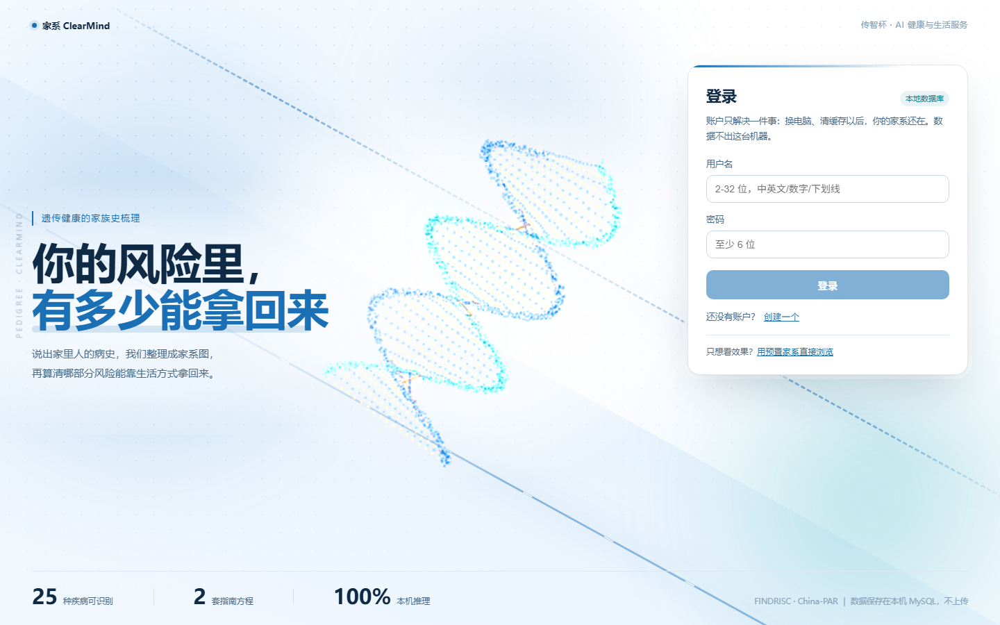
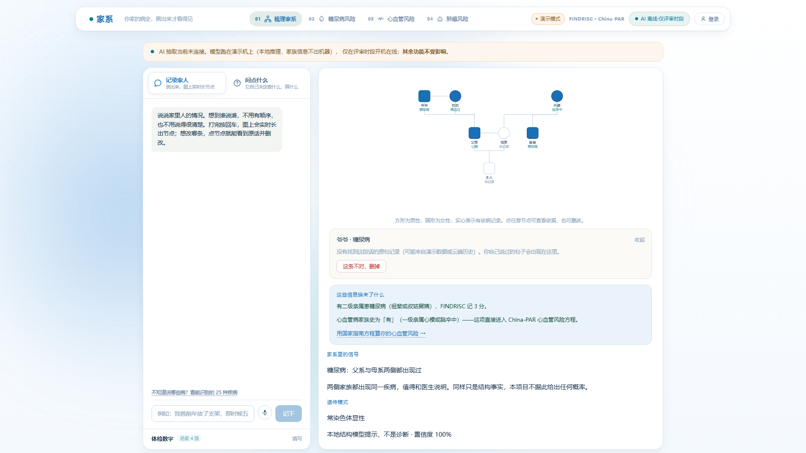
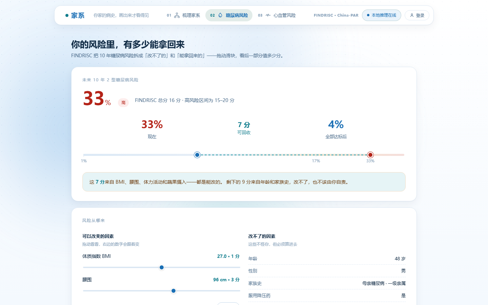
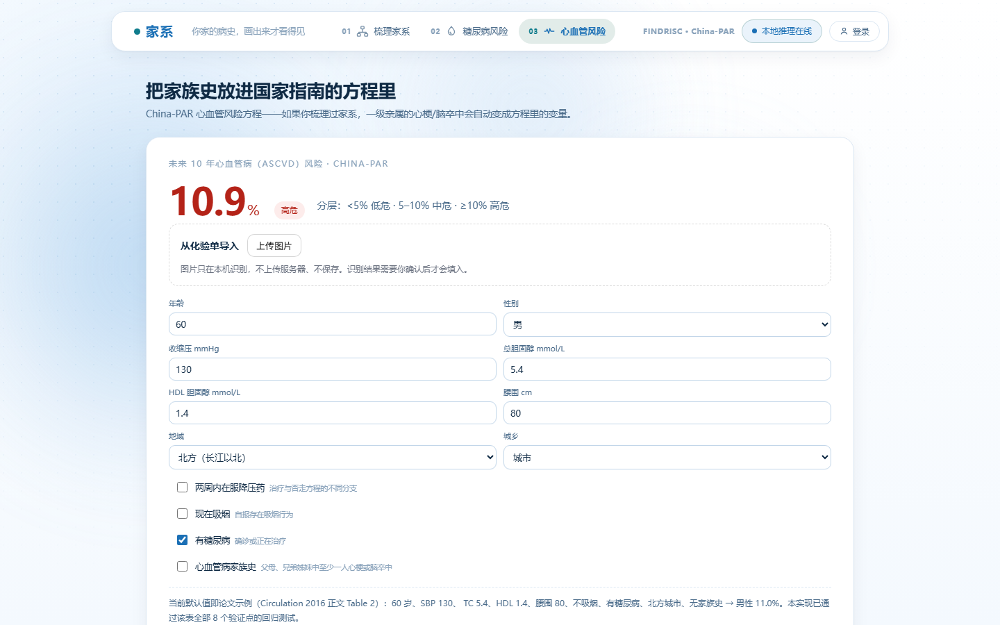

# 家系

**把家族口述的病史整理成一张家系图，算出你的风险里有多少是「能拿回来的」，并给出这周就能做的一步。**

赛道：AI + Web / AI 与健康

---

## 界面

| 登录（划开即进入） | 家系梳理 |
| --- | --- |
|  |  |

| 可回收风险（FINDRISC） | 心血管风险（China-PAR） |
| --- | --- |
|  |  |

> 截图取自 demo 账号的真实运行界面，未做后期处理；数字滚动动画在「减少动态效果」下直接显示终值。

---


## 先看这个（3 分钟，不用读代码）

| | |
| --- | --- |
| **在线演示** | https://clear.ysti.com.cn |
| **体验账号** | `demo` / `demo123`（不登录也能看第 1 步） |
| **免登录入口** | `/chat?demo=1`（预置家系，不依赖模型）；`/?demo=1`（免登录看可回收风险滑块） |
| **站点入口** | 未登录访问会先到 `/login`（左侧是 DNA 双螺旋，右侧登录/注册） |

**按顺序点三下就能看懂：**

1. **看它长什么样** → 打开 `/chat?demo=1`：家系图 + 两张风险卡（糖尿病 / 心血管）
2. **看 AI 在干什么** → 打开 `/chat`，输入一句口语，例如
   「我爸五十岁放了支架，我妈有糖尿病，我爷爷是肝癌走的」
   → 节点实时长出来；**点任意节点能看到它是从哪句话抽出来的**；
   右侧「体检数字」里改 BMI 或腰围，风险卡会立刻重算
3. **看「可回收风险」** → 打开首页（`/` 或免登录的 `/?demo=1`），
   拖 BMI / 腰围 / 体力活动 / 蔬果四个滑块，看总分与分档怎么变；
   `/cvd` 页是 China-PAR 心血管方程，可以直接填数字，
   也可以上传一张化验单自动填（年龄 / 收缩压 / 总胆固醇 / 高密度脂蛋白）

> 全部推理在本机完成（抽取用 Qwen3-1.7B + 语法约束，化验单识别用 Qwen2.5-VL），
> 家族信息不出机器。模型服务离线时页面会明确提示，家系图 / 风险 / 依据检索仍然可用。

## 现在做到哪一步

| 项 | 状态 |
| --- | --- |
| 口述病史抽取（含否定句、手术类说法、泛称癌种兜底） | 完成，**6 套留出集共 180 条**，最新 P/R/F1 = 1.000（每套全新措辞、只跑一次） |
| 家系图可视化 + 节点回溯原话 | 完成 |
| 三个风险引擎（FINDRISC 0–26 / China-PAR 2016 / PLCOm2012） | 完成，三套系数均有文献台账并进回归测试（PLCOm2012 只对曾经吸烟者出数） |
| Agent 问答（工具调用 + 知识库检索 + 引用校验） | 完成，见下方 RAG 的 A/B |
| 化验单拍照导入 | 完成（可选，需要视觉模型在线） |
| 账户与云端同步 | 完成（含「删空也同步」这个易错点） |
| 单元测试 / 类型检查 | **238 个用例 / 31 个文件**通过，`tsc --noEmit` 0 错误 |
| 技术文档 | 已提交：PDF 18 页（`docs/submit/tech.html` 为源，Edge 打印成 PDF） |
| 作品介绍文档 | 已提交：PDF 7 页（`docs/submit/intro.html` 为源） |
| 演示视频 | 已提交 [B 站：BV1ctsk6HEDH](https://www.bilibili.com/video/BV1ctsk6HEDH/) （5 分 35 秒，1080p） |
| 队伍信息 | 无限进步 · 45537 · 常州信息职业技术大学 · C 组 · 3 人 |

---

## 技术文档与作品介绍（提交材料）

| 材料 | 源文件 | 成稿 | 说明 |
| --- | --- | --- | --- |
| 技术文档（18 页） | `docs/submit/tech.html` | PDF，见提交包 `02-技术文档/` | 概述 / 需求 / 架构 / AI 方案（选型·集成·优化）/ 实现 / 测试与部署 / 创新点 / 展望 |
| 作品介绍（7 页） | `docs/submit/intro.html` | PDF，见提交包 `03-作品介绍/` | 项目详情与使用方式 / 亮点 / AI 落地 / 关键技术 / 图片 / 发表获奖 / 是否基于其他项目 |

两份都是 HTML 排版 + 无头浏览器打印成 PDF（`msedge --headless --print-to-pdf`），改内容只需改 HTML 再打印，不依赖 Office。
| 准确性说明 | `docs/准确性说明.md` | 面向评审的成稿：留出集制度、失败分析、微调 A/B、做不到的边界、复现命令 |
| 评测产物 | `docs/eval-results/*.json` | 每次评测的 commit + 模型 + 逐条预测，可逐条复核 |
| 引用台账 | `docs/references.md` | 每个进入产品的系数都登记出处与核实状态 |

PPT 不是手工排的，改内容重跑脚本即可（背景、图标、示意图都是程序生成，无外部素材与版权问题）：

```bash
python scripts/deck_art2.py     # 重新生成六套栏目背景 + 设备外框
python scripts/deck_icons.py    # 重新生成双色图标集
python scripts/build_deck_v2.py # 生成 PPT（数据页的表格在构建时从 jsonl 现算）
```

## 提交物（完整作品包）

报名表第 5 项要求上传**完整作品文件**到网盘。作品包结构与内容：

| 目录 | 内容 | 说明 |
| --- | --- | --- |
| `00-评审说明.txt` | 部署方式与限制、复现步骤、已知边界 | 先读这个 |
| `01-演示视频/` | `家系-演示视频-1080p.mp4`（5 分 35 秒）+ SRT 字幕 | 说明片 + 真实操作录屏 + 技术亮点；在线观看 [B 站：BV1ctsk6HEDH](https://www.bilibili.com/video/BV1ctsk6HEDH/) |
| `02-技术文档/` | 技术文档 PDF（18 页）+ HTML 源 | 见下方「技术文档与作品介绍」 |
| `03-源码/` | 完整可运行源码（本仓库快照） | 含录屏素材，可重渲演示视频 |
| `04-文档/` | 技术设计、评测记录、引用台账、审计记录 | `docs/` 全量 |

- 代码仓库（在线浏览）：https://github.com/NimuStudio/jiaxi
- 在线演示：https://clear.ysti.com.cn （账号 `demo` / `demo123`）
- **演示视频（B 站）**：[B 站：BV1ctsk6HEDH](https://www.bilibili.com/video/BV1ctsk6HEDH/) （5 分 35 秒，1080p）
- **完整作品（网盘）**：[夸克网盘（提取码 fhwv）](https://pan.quark.cn/s/06c96f8f2d14?pwd=fhwv) 　提取码 `fhwv`（约 193 MB，本项目压缩包即为该文件）

## 一句话说清它解决什么

体检报告说「未见异常」，但很多人心里清楚：我爸 52 岁放的支架，我爷爷糖尿病，我外婆是脑溢血走的。
这些信息存在，却从来没有一个地方把它们**画出来、换算成风险、再告诉你今年该做什么**。

家系做三件事：

1. **说出来** → 你口语描述，模型抽成结构化家系节点，图上实时长出节点
2. **看见风险** → 双引擎：FINDRISC 糖尿病（把风险拆成「改不了的」和「能拿回来的」）+ China-PAR 心血管（国家指南方程，家族史直接进方程）
3. **知道做什么** → 从可回收项里挑两件本周能做的，带最小动作而不是方向

---

## 核心概念：可回收风险

绝大多数健康产品止步于「你风险偏高」。问题是这句话没法行动——改不了的部分让人焦虑，能改的部分又没被量化。

家系把 FINDRISC 的八个条目拆成两组：

| 改不了 | 能改 |
|---|---|
| 年龄、家族史、既往高血糖史 | BMI、腰围、体力活动、蔬果摄入 |

后三项（四项）全部做到 0 分，总分下降多少，就是**可回收的分数**。

```
现在 33%  ┃████████████░░░░░┃  4% 全部达标后
          └── 可回收 7 分 ──┘
```

这样「注意身体」就变成了一个能算、能比较、三个月后能重新验证的数字。

---

## 创新点

按「选题 / 技术方案 / 交互」三条列，每条都能在代码里找到对应实现。

### 1. 选题创新：把「改不了的风险」和「能改的风险」分开算

健康类产品普遍止步于「你风险偏高」，这句话不可行动：改不了的部分制造焦虑，能改的部分又没被量化。
家系把 FINDRISC 的八个条目拆成两组，只对「能改」的四个条目做反事实推算，输出一个可回收分数。
落点是「这周就能做的一步」，而不是又一个体检报告。

### 2. 技术方案创新：本地约束解码 + 可溯源抽取

| 做法 | 为什么 | 代码位置 |
| --- | --- | --- |
| 全本地推理（Qwen3-1.7B GGUF + llama.cpp） | 家族病史是敏感信息，不出机器，也不受 API 额度与限流影响 | `src/lib/extract/client.ts` |
| GBNF 约束解码 | 结构化输出由语法保证，而不是靠 prompt「祈祷」模型吐 JSON | `src/lib/extract/grammar.ts` |
| 病名必须能回查原文 | 抽出来的每一条都要在用户原话里找到依据，抽不出就宁可不抽 | `src/lib/extract/lexicon.ts` + 评测口径 |
| 三引擎互补 | FINDRISC 覆盖糖代谢、China-PAR 覆盖心血管、PLCOm2012 覆盖肺癌（含吸烟量与家族史） | `src/lib/risk/findrisc.ts`、`src/lib/risk/chinapar.ts`、`src/lib/risk/plcom2012.ts` |
| 数字可溯源 | 每个进入产品的系数都登记出处与核实状态 | `docs/references.md` |
| 抽取准确性可复算 | 6 套「全新措辞、只跑一次」的留出集共 180 条；最新 Precision / Recall / F1 = 1.000；每次评测留痕，产物可追溯 | `docs/准确性说明.md` |

### 3. 交互创新：口述 → 追问 → 点选回溯 → 反事实推演

1. **口述即输入**：支持语音（Web Speech API，不支持时按钮自动隐藏，不留坏入口）与自然语言文本；
2. **Agent 主动追问**：模型通过工具调用判断缺哪些字段，反问用户而不是让用户填表；
   工具集为 `summarize_pedigree` / `compute_risk` / `search_knowledge`（`src/lib/agent/tools.ts`）；
3. **点击回溯**：家系图上的每个节点都能点回抽取它的那段原话，让「AI 说的」变成「你说过的」；
4. **反事实滑块**：拖动 BMI / 腰围 / 运动 / 蔬果，实时看风险下降多少，把「可回收风险」做成可交互的形态。

## 技术架构

```
浏览器
  ├── /chat    对话 + 家系图（实时生长、节点可点、依据可查）
  │              语音输入（Web Speech API，zh-CN）
  │              Agent 问答（模型自主调工具，事实卡直渲数字）
  ├── /         糖尿病风险量化（反事实滑块）+ 行动方案 + 依据检索
  ├── /cvd      心血管风险（China-PAR，家系图自动读出家族史）
  └── /lung     肺癌风险（PLCOm2012，吸烟量与家族史一起进方程）
        │
        ▼
Next.js 16 (App Router, TypeScript)
  ├── /api/extract         口述 → 家系节点（调本地 LLM）
  ├── /api/extract/stream  同上 · SSE 流式返回抽取阶段（分句→逐句→合并）
  ├── /api/agent           Agent 工具调用循环（GBNF 枚举决策）
  └── /api/explain         依据检索（BM25，语料已核实）
        │
        ▼
本机 llama.cpp server (127.0.0.1:8080)
  └── Qwen3-1.7B Q4_K_M + GBNF 约束解码

scripts/mcp-server.ts
  └── 同一套工具（summarize_pedigree / compute_risk / search_knowledge）
      以标准 MCP 协议（stdio）对外暴露，供 Claude Desktop 等客户端接入
```

### 三个关键设计决定

**1. 本地推理，而不是云 API**

家族病史是最敏感的个人信息之一。全链路在本机完成，数据不出这台电脑。
顺带还有两个好处：不受网络与额度影响，评审期稳定可用；能用上 GBNF 约束解码。

**2. GBNF 约束解码 + 三层校验**

约束解码保证输出一定合法 JSON，但保证不了内容正确。所以在模型外面加了三层：

| 层 | 作用 | 解决什么 |
|---|---|---|
| 分句抽取 | 按句切开、逐句抽、合并去重 | 长句里漏掉第二个亲属 |
| 词表校正 | 句中只有唯一称谓时以词表为准 | 模型把「老爹」抽成伯叔 |
| 证据校验 | 抽出的病必须在原文里找得到 | 模型凭空多出一个病 |

**3. 每个数字都能追溯**

- 家系节点 → 点开能看到「依据：你第 2 轮说的原话」，也能直接删
- 风险分数 → 点开「查依据」能检索到对应条目与文献出处
- 引用错误 → `docs/references.md` 连**修正过的错误**都留了档

**4. 数字与措辞分离（Agent 层）**

模型只输出文字判断，界面上的风险数字由工具返回的结构化事实直接渲染
（事实卡），不经模型复述——1.7B 复述时会把「可回收 7 分」说成「可回收率 4%」，
健康场景里这种错不能靠提示词兜。

## MCP 接入

三个核心工具同时以标准 MCP 协议暴露（`scripts/mcp-server.ts`，stdio 传输，
复用 `src/lib` 同一套实现——网站内走自研 Function Calling，站外走 MCP 标准，
两条通道共享一个工具层）：

```json
{
  "mcpServers": {
    "jiaxi": {
      "command": "npx",
      "args": ["tsx", "scripts/mcp-server.ts"],
      "cwd": "<本项目根目录>"
    }
  }
}
```

也可直接运行 `pnpm mcp` 启动。

---

## 快速开始

### 环境要求

- Node.js ≥ 20（开发用 22）
- pnpm ≥ 9
- MySQL 8（账户与数据同步用；不装也能跑，只是没有登录功能）
- Python 3.13（仅重新训练时需要）
- 可选：NVIDIA GPU（推理可跑 CPU，只是慢一个数量级）

**GPU 需要 CUDA 运行时的三个 DLL**（`cublas64_13` / `cublasLt64_13` / `cudart64_13`）。
官方 `llama-*-bin-win-cuda-*` 包里**不含**它们，缺了不会报错，只会静默回落到 CPU——
表现为日志里只有 `n_threads` 而没有 CUDA 行。把 `cudart-llama-bin-win-cuda-*` 里的
三个 DLL 复制到 `llama-server.exe` 同目录即可（本机做法见 `D:\develop\llama\README-cuda-runtime.txt`）。
验证：`llama-server.exe --list-devices` 应输出 `CUDA0: NVIDIA GeForce RTX 5080`。

本机实测（RTX 5080 16 GB，Qwen3-1.7B Q4_K_M，4k 上下文）：

| | CPU 路径 | GPU 路径 |
| --- | --- | --- |
| 模型启动到首个可用响应 | 2.7 s | **1.7 s** |
| 单句家族史抽取（含 GBNF） | 1.22 s | **0.11 s** |
| 显存占用 | — | **1.8 GB** |

### 0. 一键启动 / 停止（演示机）

桌面上有两个快捷脚本（实际逻辑在仓库里，桌面脚本只是转调）：

| 桌面脚本 | 实际文件 | 作用 |
| --- | --- | --- |
| 启动家系演示 | `scripts/start-demo.cmd` | 自动拉起 MySQL、llama-server、站点、反向隧道，最后打开 https://clear.ysti.com.cn。已在运行的组件全部跳过 |
| 停止家系演示 | `scripts/stop-demo.cmd` | 停掉站点、llama-server、隧道（含守护循环）；MySQL 服务保留不动 |

两个脚本都是 **GBK + CRLF** 编码（cmd 的要求）。改脚本时注意别存成 UTF-8/LF，
否则中文会乱码、行尾会被截断——重写后可用文件工具以外的命令转码：

```bash
iconv -f UTF-8 -t GBK scripts/start-demo.cmd | sed 's/$/\r/' > tmp && mv tmp scripts/start-demo.cmd
```

### 1. 装前端依赖并启动

```bash
pnpm install
pnpm dev          # http://localhost:5173
```

### 2. 启动本地推理服务

```bash
# 模型：Qwen3-1.7B-GGUF（Q4_K_M），放在任意路径
llama-server -m /path/to/qwen3-1.7b-q4_k_m.gguf -ngl 99 -c 4096 --port 8080
```

> 推理服务不启动时，页面能正常打开，只是对话功能会提示「本地推理服务未启动」。
> 访问 `/chat?demo=1` 可以看到预置家系的完整效果，不需要模型。

### 3. 生产模式

```bash
pnpm build && pnpm start   # 同样在 5173
```

### 3.5 可选：化验单识别（视觉模型）

`/cvd` 页可以把化验单拍照导入，自动填年龄、收缩压、总胆固醇、高密度脂蛋白：

```bash
# 需要带 --mmproj 的视觉模型；不启动时该入口自动隐藏，其余功能不受影响
llama-server -m ml/vlm/model.gguf --mmproj ml/vlm/mmproj.gguf -ngl 99 -c 4096 --port 8082
```

模型文件在 `ml/vlm/`（Qwen2.5-VL-3B Q4 + mmproj，共 2.6 GB，不入版本库）。
识别结果**逐项确认后才填入**，图片不落盘、不入库。方案对比与实测数字见 `docs/lab-ocr-verification.md`。

### 4. 数据库（账户功能）

```sql
-- root 登录 MySQL 后执行：
CREATE DATABASE pedigree CHARACTER SET utf8mb4 COLLATE utf8mb4_unicode_ci;
CREATE USER 'pedigree_app'@'localhost' IDENTIFIED BY '<随机密码>';
GRANT ALL PRIVILEGES ON pedigree.* TO 'pedigree_app'@'localhost';
```

然后写 `.env.local`（已 gitignore，参考 `.env.example`）：

```
MYSQL_HOST=127.0.0.1
MYSQL_PORT=3306
MYSQL_USER=pedigree_app
MYSQL_PASSWORD=<随机密码>
MYSQL_DATABASE=pedigree
```

表结构（users / sessions / pedigrees / risk_factors）在首次访问时自动创建。

### 环境变量

见 `.env.example`：

```
LLAMA_SERVER_URL=http://127.0.0.1:8080   # 本地推理服务
MYSQL_*                                  # 账户数据库（见上节）
```

---

## 账户与数据同步

**为什么加账户**：家系和体检数字是个人健康数据，绑定个人而不是绑定浏览器——
换电脑、清缓存后登录即可找回。

**隐私口径不变**：MySQL 与站点、模型跑在同一台演示机上，数据不出机器。

| | 未登录 | 已登录 |
|---|---|---|
| 数据存哪 | 浏览器 localStorage | localStorage（工作副本）+ 本机 MySQL（持久层） |
| 换设备 | 数据不跟随 | 登录即恢复 |
| 登出后 | — | 云端数据保留，本地继续可用 |

实现要点：

- 密码 scrypt 哈希（node:crypto，无原生依赖）；会话是服务端表 + httpOnly cookie，登出即失效；
- 登录后先「双向对账」：云端有数据 → 拉下来与本地合并（谁都不丢）；
  云端为空 → 本地数据自动迁移上云；之后每次变更 800ms 防抖自动备份；
- API 入口对数据结构做白名单校验（`/api/me/pedigree`、`/api/me/factors`），
  畸形数据不入库。

---

## 在线部署

演示地址：https://clear.ysti.com.cn
体验账号 `demo` / `demo123`；不想动数据可用 `/chat?demo=1`（预置家系，不读云端、不依赖模型）。

### 部署现状（2026-11-17 实测）

| 检查项 | 结果 |
|---|---|
| `GET https://clear.ysti.com.cn/` | 200（风险量化页） |
| `GET https://clear.ysti.com.cn/chat?demo=1` | 200（预置家系，完整可交互） |
| `GET https://clear.ysti.com.cn/cvd` | 200（China-PAR 心血管风险） |
| `POST /api/extract`（无模型时） | **503** + 明确提示（见下节「降级行为」） |
| `GET /api/extract` | `{"ready":false}` |

也就是说：**站点与全部界面功能常驻服务器，不依赖任何本地机器**；
只有「口述 → 抽取」这一步需要模型，模型缺位时按设计降级，不会白屏、不会 502。

### 架构：站点常驻服务器，模型可选

```
浏览器
  → nginx（云服务器 1.6G 内存，Let's Encrypt TLS）
  → systemd: pedigree.service
  → Next.js 16（127.0.0.1:5173，服务器本地常驻）
        ├→ LLAMA_SERVER_URL（可选，指向本地/隧道上的 llama-server）
        └→ MySQL（可选，仅账户与同步）
```

| 组件 | 跑在哪 | 必需性 |
|---|---|---|
| nginx + TLS | 云服务器 | 必需 |
| Next.js 站点 | 云服务器 `/opt/pedigree`（systemd 常驻） | 必需 |
| llama-server（Qwen3-1.7B） | 演示机 GPU，或任何能跑 1.2G 模型的机器 | **可选** |
| MySQL 8 | 任意可连实例 | 可选（仅登录/同步） |

**这么部署的原因**：评审期这台开发机不能一直开机，所以站点必须独立跑在服务器上。
模型和数据库依赖重资源，服务器（1.6G 内存）放不下，于是按「放不下就只跑界面」的取舍处理——
**站点与全部界面功能常驻服务器，模型缺位时只有「口述 → 抽取」降级。**

### 降级行为（实测）

模型未连接时：

| 接口 / 页面 | 行为 |
|---|---|
| `POST /api/extract` | 返回 **503**，body 为 `{"error":"AI 抽取服务当前未连接（模型运行在演示机上，仅在评审时段在线）…"}` |
| `GET /api/extract` | `{"ready":false}`，前端据此显示「模型未启动」提示 |
| `/`、`/cvd`、`/lung` | 200，风险量化、反事实滑块、依据检索全部可用（纯本地计算） |
| `/chat?demo=1` | 200，预置家系完整可交互（不读云端、不依赖模型） |

2026-11-17 实测（服务器上，本地演示机全部关停）：

```
/           -> 200
/chat       -> 200
/chat?demo=1-> 200
/cvd        -> 200
POST /api/extract -> 503（上面那段提示）
```

### 服务器上怎么跑

| 项 | 值 |
|---|---|
| 代码目录 | `/opt/pedigree`（只放运行时产物：`.next/` + `package.json` + `next.config.ts`） |
| 服务 | `systemctl status pedigree`（`Restart=always`，开机自启） |
| 监听 | `127.0.0.1:5173`（`next start`），只对 nginx 暴露 |
| nginx | `/etc/nginx/sites-enabled/zz-clear` → `proxy_pass http://127.0.0.1:5173` |
| 日志 | `journalctl -u pedigree -n 50 --no-pager` |

更新部署（在开发机上，脚本会自动构建 + 上传 + 重启 + 健康检查）：

```bash
bash infra/deploy.sh
```

> 为什么在本地构建：服务器 1.6G 内存，`next build` 会 OOM。所以本地产出 `.next/` 运行时产物，
> 只上传约 7MB（不含 `.next/cache` 与 `.next/dev`），服务器只做 `pnpm install --prod`。
> `infra/` 目录（部署脚本、nginx 配置、隧道脚本）不在本仓库内，属于部署机本地文件。

#### 1.6 GB 小机器的资源处理

| 项 | 做法 | 实测 |
|---|---|---|
| 内存 | Next.js + MySQL 两个进程常驻 | 约 125 MB + 145 MB，可用约 900 MB |
| Swap | 两个 swapfile 共 6 GB | 占用约 100 MB |
| MySQL 收紧 | `innodb_buffer_pool_size` 128M → 64M、`performance_schema=OFF`、`max_connections` 151 → 30 | mysqld 常驻 **403 MB → 145 MB** |
| Node 堆上限 | `NODE_OPTIONS=--max-old-space-size=384` | 防止单进程无限增长 |
| 自愈 | `pedigree`、`mysql` 都 `systemctl enable` + `Restart=always`（MySQL 默认只有 `on-failure`） | 异常退出 3 秒后自动拉起 |

调优配置：`infra/mysql-small.cnf`（部署机本地文件，不入仓库）。
即使 MySQL 意外退出，页面与全部计算功能仍可用，只有「登录 / 同步」受影响——这是刻意的降级设计。

### 评审期间启用模型（可选）

若希望线上「口述 → 抽取」也可用，在任意 GPU 机器上起模型并让服务器可达即可：

```bash
# 模型侧（演示机）
llama-server -m qwen3-base-Q4_K_M.gguf -ngl 99 -c 4096 --port 8080 --host 127.0.0.1

# 服务器侧：把 LLAMA_SERVER_URL 指过去（本地反代或隧道均可）
systemctl edit pedigree   # Environment=LLAMA_SERVER_URL=http://127.0.0.1:8080
systemctl restart pedigree
```

不启用时，界面、风险计算、依据检索、示例家系全部正常——这是刻意设计的降级路径。

## 目录结构

```
pedigree/
├── app/
│   ├── page.tsx              风险量化页
│   ├── chat/page.tsx         对话 + 家系图
│   └── api/
│       ├── extract/          抽取接口
│       ├── explain/          依据检索接口
│       └── agent/            Agent 问答接口（工具调用决策）
├── src/
│   ├── lib/
│   │   ├── risk/findrisc.ts      FINDRISC 评分 + 可回收风险
│   │   ├── risk/chinapar.ts      China-PAR 心血管方程（论文 8 点回归验证）
│   │   ├── agent/                Agent 工具调用层（GBNF 决策 + 事实卡）
│   │   ├── pedigree/             家系数据模型、血缘查询、图布局
│   │   ├── extract/              抽取客户端、GBNF 语法、词表
│   │   └── rag/search.ts         BM25 检索
│   └── components/           模拟器、家系图、聊天、行动方案、依据面板
├── data/
│   ├── eval/                 评测集（规整 16 条 + 口语 6 套留出集共 180 条）
│   ├── kb/                   已核实知识库
│   └── train/                训练数据（1080 + 120 条）
├── scripts/                  数据生成、评测、词表缺口扫描
│   ├── eval-extract.ts       跑留出集（自动落盘产物）
│   ├── lexicon-gaps.ts       扫描「出现但词表没收录」的称谓与病名
│   └── create-user.mjs       创建/重置评审账号（建表类型须与 db.ts 一致）
├── docs/
│   ├── submit/               提交文档源（tech.html / intro.html → 打印成 PDF）
│   ├── references.md         引用台账（已核实 / 已修正 / 待核实）
│   ├── 准确性说明.md          面向评审的准确性成稿（方法 + 证据 + 边界）
│   ├── lexicon-gaps.md       词表缺口（自动生成）
│   └── deck-assets/          PPT 背景、家系示意图、图标（脚本生成，可重跑）
```

---

## 评测

### 留出集制度（对外只报这一组）

每套留出集都是**全新措辞、只跑一次**；跑过即降级为开发集，不再对外报数。
每次评测自动落盘：`docs/eval-results/<时间>-<集名>.json`（含 commit、模型、逐条预测）。

| 留出集 | 期间做了什么 | 样本 | Precision | Recall | F1 | 完全匹配 |
|---|---|---|---|---|---|---|
| v2 | 规则修补（称谓 / 续句 / 病种回退） | 30 | 0.962 | 0.806 | 0.877 | 23/30 |
| v3 | 按缺口清单系统补词表 | 30 | 0.958 | 0.793 | 0.868 | 23/30 |
| v5 | 规则抽取兜底 + few-shot | 30 | 1.000 | 0.839 | 0.912 | 25/30 |
| v7 | 支架/血压变体、续句用原话、状语前置、疑问句非否定 | 30 | 1.000 | 0.933 | 0.966 | 28/30 |
| v8 | 血糖 / 心脏别名变体 | 30 | 1.000 | 0.966 | 0.982 | 29/30 |
| **v9** | **裸「支架」入表** | 30 | **1.000** | **1.000** | **1.000** | **30/30** |

六套合计 180 条，其中含年龄 10、否定句 12、续句 13、多人句 20——不是同一模板换词。
30 条样本的置信区间约 ±10%，所以对外写「30 条全新措辞、只跑一次」，不写成「准确率 100%」。
完整方法、失败分析与复现命令见 **`docs/准确性说明.md`**。

### 早期两套评测集（历史记录，不再对外报数）

这两套跑过多轮调优，已降级为开发集——它们的 1.000 不能作为对外成绩，
保留在此是为了说明「开发集涨、留出集跌」那次的过拟合是怎么被发现的。

| 评测集 | Precision | Recall | F1 | 关系-疾病对完全匹配 | 年龄准确率 |
|---|---|---|---|---|---|
| 规整句（16 条） | 1.000 | 1.000 | **1.000** | 16/16 | — |
| 口语（29 条） | **1.000** | **1.000** | **1.000** | 29/29 | 28/31 = 0.903 |

> 「完全匹配」只比较**关系-疾病对**；发病年龄单独计分（口径与脚本一致，未做美化）。

**口语集 Precision = 1.000** 是这套设计最想拿到的数字：抽出来的每一个病，都能在用户原话里找到依据。早期版本在这条约束下 Recall 只有 0.750，靠三层修补拉平：词表补谓语变体、分句时把无称谓的续句（「后来中风了」）继承上一句主语、few-shot 补并列句式。

口语集从 21 条扩到 29 条时，新加的 8 条**对抗样本**立刻抓到 4 个真实缺陷，全部已修：

| 缺陷 | 现象 | 修法 |
| --- | --- | --- |
| 手术类说法无法归位 | 「放了支架」「做了心脏搭桥手术」→ other，家族史在风险计算里消失 | 送模型前用词表把口语说法归一成规范病名（normalizeSegment） |
| 模型编造发病年龄 | 「我大伯胃癌，做完手术了」→ 凭空给 50 岁（年龄是 FINDRISC/China-PAR 的核心输入） | 年龄必须在原文里找得到，否则置空（groundAge + 中文数字解析） |
| 泛称病名被整条丢弃 | 「我爷爷肝癌走的」→ 模型吐泛称「癌症」，回查不到就整条删，结果为空 | 用词表在原文里找回最长命中兜底（rescueCondition） |
| 一句话两主语共享一个病 | 「我爸和我叔都心梗」→ 只抽到父亲 | 输出只有 1 人且句中有并列词时，按词表补齐其余亲属（expandSharedCondition） |

每一条都配了单元测试，测试数从 44 增至 61。

### 检索增强（RAG）的 A/B

同一批 11 个问题，分别在有知识库与 `?noKb=1`（不给知识库）两种条件下跑：

| 条件 | 通过率 | 有依据引用 | 平均耗时 |
| --- | --- | --- | --- |
| 有知识库 | **11/11** | 5/11 | 5341 ms |
| 无知识库 | 6/11 | 0/11 | 3397 ms |

知识库类问题 **6/6 vs 1/6**。三次运行有波动（有 KB 8→10→11，无 KB 4→5→6），不要只挑一次看。方法、题目与已知不足见 `docs/rag-ab.md`；
复现：`node scripts/eval-rag.ts`（需站点与 llama-server 在运行）。

复现：

```bash
pnpm test                                              # 单元测试
node scripts/eval-extract.ts                            # 规整集（需 llama-server）
node scripts/eval-extract.ts --file=data/eval/colloquial-eval.jsonl   # 口语集
```

> 说明：口语集仅 21 条，单条结果存在随机波动，指标不宜过度解读。

---

## 已知局限

诚实写在这里，避免被当成没有边界的作品：

- **风险量化覆盖糖尿病与心血管两类**（FINDRISC、China-PAR 双引擎）。其他病种（如肿瘤家族史对应的筛查建议）未上线——筛查起始年龄依赖中国指南原文逐条核实，没核实就不出现在产品里。
- **筛查建议未上线**。结直肠癌、乳腺癌的筛查起始年龄依赖中国指南原文，尚未逐条核实，因此产品里不出现。
- **口语评测集规模仍小**（29 条），且由开发者编写而非真实采集；对抗样本是「发现一批补一批」，覆盖面不等于真实分布。
- **词表是子串匹配**，「放了心脏支架」这类说法需要逐个补进词表，存在覆盖不全的风险。
- **吸烟与饮酒的处理不一致，这是有意的**：吸烟是 China-PAR 方程里的独立变量，会改变心血管风险；
  饮酒**不在** FINDRISC 与 China-PAR 的任何一项里，所以只作记录、不改变分数（界面会明确写出来）。
- **家系 × 环境的交互只给提示，不给概率**。例如「一级亲属有肺部疾病 + 你在吸烟」值得更积极评估，
  但我们找不到可引用的中国人群交互模型，因此只说明该组合值得与医生讨论筛查，不给出任何百分比 ——
  宁可不给数字，也不编一个。
- **语音识别依赖浏览器引擎**（Web Speech API），Chrome / Edge 可用，Firefox 不支持——不支持时麦克风按钮自动隐藏，不提供坏掉的入口。
- **在线演示中，AI 抽取依赖演示机在线**。站点本身常驻服务器、始终可用；但大模型是本地推理（家族信息不出机器），需要通过 SSH 反向隧道从演示机接入。演示机关机时抽取接口返回 503，页面顶部会明确提示，家系图、风险量化、依据检索等其余功能不受影响，也可用 `?demo=1` 加载示例家系浏览完整形态。

---

## 参考资料

所有进入产品的数字都在 `docs/references.md` 里登记了出处与核实状态。主要文献：

- Lindström J, Tuomilehto J. The diabetes risk score: a practical tool to predict type 2 diabetes risk. *Diabetes Care*. 2003;26(3):725-731. PMID 12610029
- 加拿大预防保健工作组（CTFPHC）FINDRISC 临床工具（8 条目、0–26 分版本）
- *Cardiovascular Diabetology* 2024（风险分层 1% / 4% / 17% / 33% / 50%）

---

## 评审说明

| 项 | 值 |
| --- | --- |
| 在线演示 | https://clear.ysti.com.cn |
| 评审账号 | `demo` / `demo123`（可登录；线上库为新建，账号内暂无数据） |
| 想直接看完整形态 | 用 `/chat?demo=1`（预置 4 人家系与体检数字，不登录、不需要模型） |
| 演示视频（B 站） | [B 站：BV1ctsk6HEDH](https://www.bilibili.com/video/BV1ctsk6HEDH/) |
| 完整作品（网盘） | [夸克网盘（提取码 fhwv）](https://pan.quark.cn/s/06c96f8f2d14?pwd=fhwv) 　提取码 `fhwv` |

> 体验账号是**共用**的：多人同时试用时，家系与体检数字会互相覆盖。
> 只想看形态不想动数据的话，用 `/chat?demo=1`（本地预置数据，不读云端）；
> 想完整体验又不想污染 demo 账号，可以在登录弹层点「注册一个」自己建一个。
| 免登录浏览 | `/chat?demo=1`（预置家系，不依赖模型） |
| 模型离线时 | 抽取接口返回 503 并在页面提示；家系图、风险量化、知识检索、反事实滑块仍可用 |

> 演示机是本机 + SSH 反向隧道：站点常驻服务器，大模型在本地（家族信息不出机器）。
> 若页面提示模型未启动，双击桌面「启动家系演示」即可恢复。

---

## 团队

| 项 | 值 |
| --- | --- |
| 队伍名称 | 无限进步 |
| 团队编号 | 45537 |
| 所属院校 | 常州信息职业技术大学 |
| 参赛组别 | C 组 |
| 团队人数 | 3 人 |

---

## License

本项目以 **MIT License** 开源，见 [LICENSE](LICENSE)。

允许商用、修改、分发，保留版权声明即可。第三方素材另有许可：
配乐为 Kevin MacLeod（incompetech.com）CC BY 4.0（片尾已署名）；
引用的论文与指南 PDF 见 `docs/references.md`，版权归原作者/出版方。